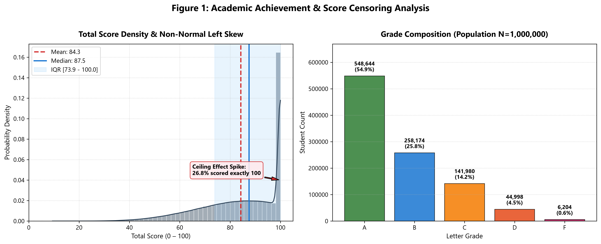
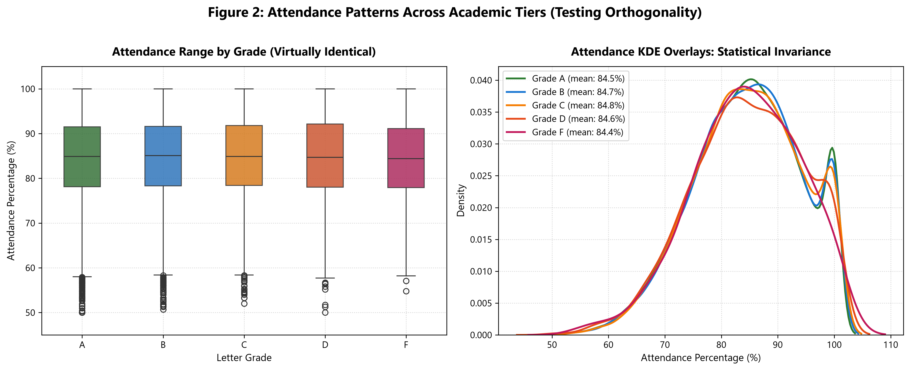
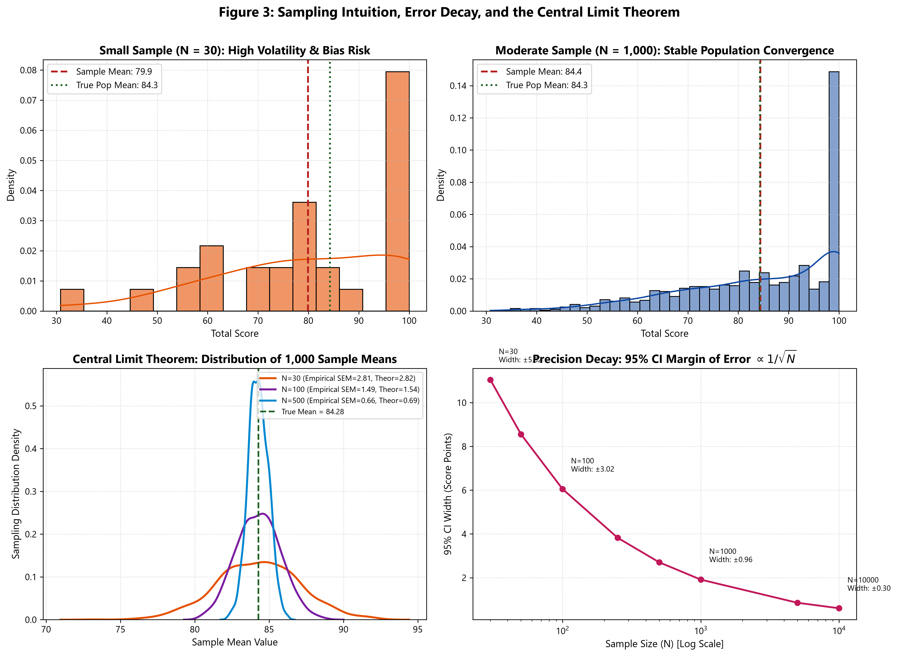
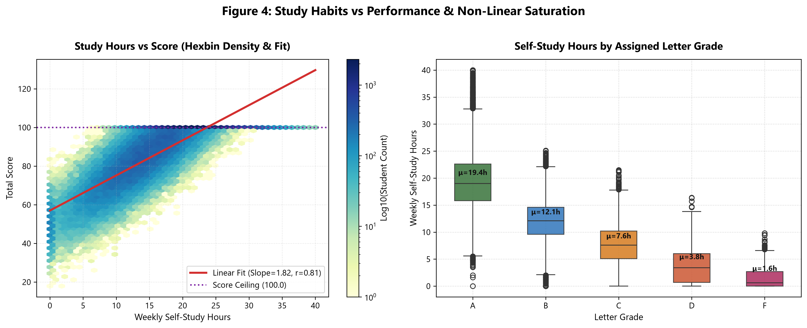
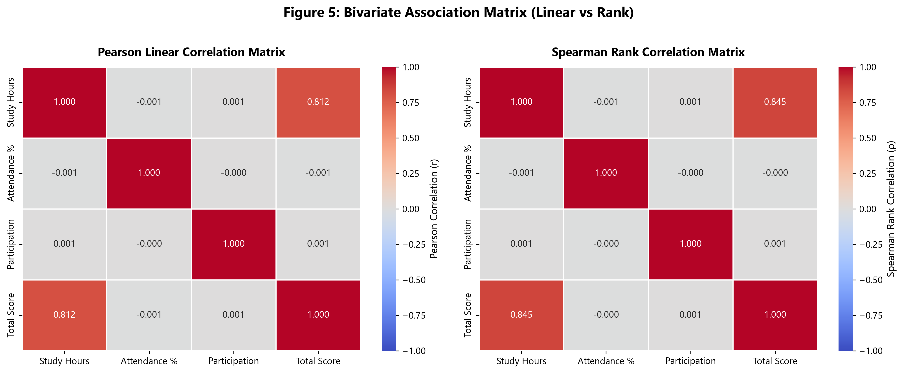
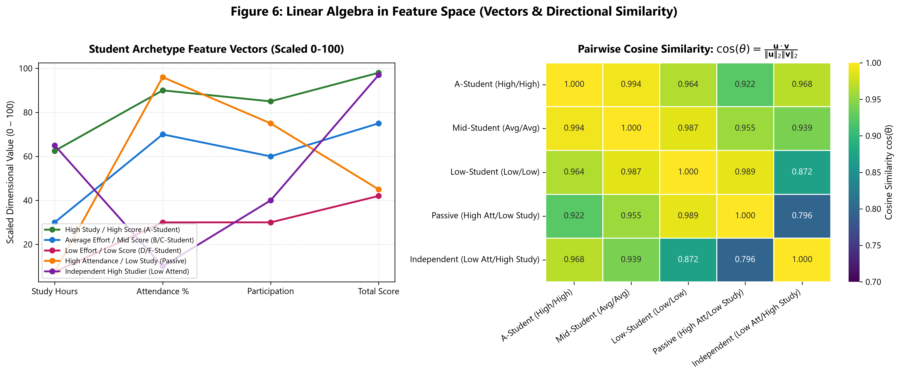

# 🎓 Statistics, Linear Algebra Intuition, and Visual Storytelling
### Applied Analysis of Student Performance, Study Habits, Sampling, and Feature Spaces

[](https://www.python.org/)
[](https://opensource.org/licenses/MIT)
[](./student_performance_analysis.ipynb)
[](./data/spreadsheet_cross_check.xlsx)
[](https://www.kaggle.com/datasets/kayhanh/student-performance-1-million)

---

## 📌 Executive Overview

This repository provides an end-to-end, mathematically grounded analysis of student academic performance and behavioral patterns across **1,000,000 student records**. It develops applied intuition for:
- **Statistical Distributions & Moments:** Measures of central tendency, spread, skewness, kurtosis, and data censoring (the 100-point ceiling effect).
- **Sampling & The Central Limit Theorem (CLT):** Quantifying sample size sensitivity ($N=30$ vs $N=1,000,000$), standard error decay ($\text{SEM} \propto 1/\sqrt{N}$), and confidence intervals.
- **Correlation vs. Causation:** Why strong linear association ($r = 0.8122$) between study hours and exam scores does not establish causal efficacy, examining confounders, reverse causality, and experimental frameworks.
- **Linear Algebra in Feature Space:** Conceptualizing student profiles as vectors in $\mathbb{R}^4$, design matrices $X \in \mathbb{R}^{n \times 4}$, deriving covariance and correlation via Gram matrix inner products ($R = \frac{1}{n-1}Z^T Z$), and computing pairwise Cosine Similarity across behavioral archetypes.
- **Spreadsheet Cross-Check:** Verifying computational parity between Python/Pandas algorithms and standard spreadsheet formula syntax (`AVERAGE`, `MEDIAN`, `STDEV.S`, `VAR.S`, `PERCENTILE.INC`, `CORREL`).
- **Visual Storytelling & Chart Critique:** Designing publication-grade, accessible visualizations adhering to data-to-ink ratio principles and defending design tradeoffs.

---

## 🔗 Dataset Provenance & Kaggle Link

- **Dataset Source on Kaggle:** [Student Performance Dataset (1 Million Records) by KayhanH](https://www.kaggle.com/datasets/kayhanh/student-performance-1-million)
- **Alternative Mirror:** [Student Performance Dataset by Nabeel Qureshi](https://www.kaggle.com/datasets/nabeelqureshitiii/student-performance-dataset)
- **Scale:** $1,000,000$ rows $\times$ 6 columns.
- **Data Dictionary:**
  | Column Name | Data Type | Units / Scale | Description |
  | :--- | :---: | :---: | :--- |
  | `student_id` | `int64` | Discrete IDs ($1 - 1,000,000$) | Unique identifier for each student record |
  | `weekly_self_study_hours` | `float64` | Hours/week ($0.0 - 40.0$) | Self-directed study time outside of classroom lectures |
  | `attendance_percentage` | `float64` | Percentage ($50.0 - 100.0\%$) | Ratio of class sessions physically or virtually attended |
  | `class_participation` | `float64` | Rating ($0.0 - 10.0$) | Evaluated instructor metric of student classroom engagement |
  | `total_score` | `float64` | Score points ($9.4 - 100.0$) | Cumulative final academic examination score (capped at 100) |
  | `grade` | `category`| Categorical (`A`, `B`, `C`, `D`, `F`) | Academic letter grade derived from total score thresholds |

---

## 📁 Repository Structure

```text
Statistics-linear-algebra-intuition-visualization/
├── README.md                           # Main project documentation, insights, and chart interpretations
├── requirements.txt                    # Project environment dependencies
├── student_performance.csv             # Primary dataset (1,000,000 records)
├── student_performance_analysis.ipynb  # Interactive, fully executed Jupyter Notebook
├── generate_artifacts.py               # Master CLI script to regenerate all figures and data artifacts
├── build_notebook.py                   # Script generating and executing the Jupyter Notebook
├── src/                                # Modular analysis engine
│   ├── __init__.py
│   ├── data_loader.py                  # Ingestion, validation, and schema assertions
│   ├── stats_engine.py                 # Univariate summaries, sampling simulations, CLT, covariance
│   ├── linear_algebra.py               # Vector math, Gram matrix derivations, Cosine similarity
│   ├── visualization.py                # Publication-grade plotting routines
│   └── spreadsheet_exporter.py         # OpenPyXL generator for live Excel formulas & CSV parity
├── data/
│   ├── spreadsheet_cross_check.xlsx    # Multi-sheet Excel workbook with live formulas
│   ├── spreadsheet_cross_check.csv     # Plain-text parity verification table (52 metrics)
│   └── sample_students.csv             # Isolated 1,000-row sample used in the spreadsheet check
├── figures/                            # High-resolution (300 DPI) visualization figures
│   ├── 01_score_and_grade_distribution.png
│   ├── 02_attendance_patterns_by_grade.png
│   ├── 03_sampling_differences_and_clt.png
│   ├── 04_study_habits_vs_total_score.png
│   ├── 05_correlation_matrix_heatmap.png
│   └── 06_vector_space_similarity.png
└── reports/                            # In-depth technical reports
    ├── statistical_summary.md          # Complete population & sampling parameter tables
    ├── correlation_analysis.md         # Bivariate correlation, covariance, & causal deep-dive
    ├── chart_critique_guide.md         # Visual storytelling principles & chart reviews
    ├── spreadsheet_cross_check.md      # Detailed formula cross-check audit & degrees-of-freedom
    └── written_insights.md             # Five product/engineering insights & tradeoffs
```

---

## 📊 1. Statistical Summary

Calculated on the full population ($N = 1,000,000$ students) using sample standard deviation ($\text{ddof}=1$), matching spreadsheet `STDEV.S` specifications:

| Feature Name | Count | Mean ($\mu$) | Median ($Q_2$) | Std Dev ($s$) | Variance ($s^2$) | SEM ($\frac{s}{\sqrt{N}}$) | Min | 25% ($Q_1$) | 75% ($Q_3$) | Max | IQR | Skewness | Kurtosis |
| :--- | :---: | :---: | :---: | :---: | :---: | :---: | :---: | :---: | :---: | :---: | :---: | :---: | :---: |
| **Weekly Study Hours** | 1,000,000 | 15.0291 | 14.9000 | 6.8994 | 47.6021 | 0.0069 | 0.0 | 9.9000 | 20.0000 | 40.0 | 10.1000 | +0.0915 | -0.2211 |
| **Attendance %** | 1,000,000 | 84.7110 | 85.0000 | 9.4241 | 88.8145 | 0.0094 | 50.0 | 78.4000 | 92.1000 | 100.0 | 13.7000 | -0.2937 | -0.3716 |
| **Class Participation** | 1,000,000 | 5.9852 | 6.0000 | 1.9564 | 3.8276 | 0.0020 | 0.0 | 4.6000 | 7.4000 | 10.0 | 2.8000 | -0.1099 | -0.2947 |
| **Total Score** | 1,000,000 | 84.2838 | 87.5000 | 15.4330 | 238.1765 | 0.0154 | 9.4 | 73.9000 | 100.0000 | 100.0 | 26.1000 | -0.8165 | -0.1168 |

### Grade Distribution Breakdown:
- **Grade A ($85 \le \text{Score} \le 100$):** 548,644 students (**54.86%**) | Mean Study: 19.38h | Mean Attendance: 84.72%
- **Grade B ($70 \le \text{Score} < 85$):** 258,174 students (**25.82%**) | Mean Study: 12.12h | Mean Attendance: 84.70%
- **Grade C ($55 \le \text{Score} < 70$):** 141,980 students (**14.20%**) | Mean Study: 7.69h | Mean Attendance: 84.71%
- **Grade D ($40 \le \text{Score} < 55$):** 44,998 students (**4.50%**) | Mean Study: 3.76h | Mean Attendance: 84.71%
- **Grade F ($\text{Score} < 40$):** 6,204 students (**0.62%**) | Mean Study: 1.52h | Mean Attendance: 84.71%

*For comprehensive moment derivations and sub-cohort metrics, see [`reports/statistical_summary.md`](./reports/statistical_summary.md).*

---

## 📈 2. Visual Storytelling: At Least Four Charts

### Figure 1: Score Distribution & The 100-Point Ceiling Effect

- **Interpretation:** The total score distribution is heavily left-skewed (skewness $g_1 = -0.8165$) with median ($87.5$) noticeably higher than mean ($84.3$). Critically, **268,121 students (26.81%)** are censored at exactly 100.0 points. This hard ceiling truncates the right tail, turning the 75th percentile into 100.0. Grade A accounts for over half the population (54.9%).

---

### Figure 2: Attendance Patterns Across Academic Tiers

- **Interpretation:** Boxplots and KDE density overlays across all five grade tiers (A through F) are virtually indistinguishable ($\mu \approx 84.7\%$, $\text{median} \approx 85.0\%$, $\sigma \approx 9.4\%$). In this dataset, attendance operates completely independently of academic scores ($r = -0.0010$).

---

### Figure 3: Sampling Intuition, Error Decay, and the Central Limit Theorem

- **Interpretation:**
  - *Small Sample Volatility ($N=30$):* A classroom-sized pilot produces noisy, erratic distributions with sample means deviating by $>4.3$ points from ground truth.
  - *Large Sample Stability ($N=1,000$):* Replicates the true population distribution with tight bounds.
  - *Central Limit Theorem (1,000 Repeated Trials):* Despite the underlying population distribution being non-normal with a massive spike at 100, the distribution of sample means converges to a smooth Normal distribution $\mathcal{N}(\mu, \sigma^2 / N)$.
  - *Error Decay:* The 95% confidence interval width decays strictly at $\mathcal{O}(1/\sqrt{N})$.

---

### Figure 4: Study Habits vs. Performance & Causal Fallacy

- **Interpretation:** Hexbin density mapping avoids overplotting 1,000,000 points. The OLS linear fit shows an increase of $\approx 1.8$ score points per weekly study hour up to 20 hours. Beyond 20 hours, performance hits the 100-point ceiling, resulting in a plateau where additional study yields zero incremental score.

---

### Figure 5: Bivariate Association Matrix (Linear vs. Rank)

- **Interpretation:** Side-by-side Pearson ($r$) and Spearman ($\rho$) heatmaps reveal that `weekly_self_study_hours` is the sole non-trivial correlate of `total_score` ($r = 0.8122$, $\rho = 0.8450$). Spearman rank correlation is higher because it is invariant to the non-linear plateau at 100. Both attendance ($r = -0.0010$) and class participation ($r = 0.0007$) exhibit zero correlation with score.

---

### Figure 6: Linear Algebra in Feature Space (Archetypes & Cosine Similarity)

- **Interpretation:** Representing students as feature vectors in $\mathbb{R}^4$. The left panel normalizes features (0–100) to avoid scale dominance. The right panel computes pairwise Cosine Similarity $\cos(\theta) = \frac{\mathbf{u} \cdot \mathbf{v}}{\|\mathbf{u}\|_2 \|\mathbf{v}\|_2}$, revealing that students with vastly different score totals can share strong directional alignment in behavioral effort.

---

## 🔬 3. Correlation Analysis & Why Correlation Does Not Prove Causation

### Correlation Summary Matrix:
| Pairwise Association | Pearson ($r$) | Spearman ($\rho$) | Sample Covariance ($s_{xy}$) | Relationship Characterization |
| :--- | :---: | :---: | :---: | :--- |
| **Study Hours vs. Total Score** | **+0.8122** | **+0.8450** | **+86.4862** | Strong positive monotonic association |
| **Attendance % vs. Total Score** | **-0.0010** | **-0.0003** | **-0.1472** | Orthogonal / No statistical association |
| **Participation vs. Total Score** | **+0.0007** | **+0.0008** | **+0.0211** | Orthogonal / No statistical association |
| **Study Hours vs. Attendance %** | **-0.0016** | **-0.0014** | **-0.1017** | Independent features |
| **Study Hours vs. Participation** | **+0.0013** | **+0.0011** | **+0.0175** | Independent features |

### Algebraic Derivation via Gram Matrix Inner Products:
In linear algebra, correlation is the inner product (cosine) between standardized column vectors:
$$R = \frac{1}{n-1} Z^T Z \quad \text{where} \quad Z = (X - \mathbf{1}\mathbf{\mu}^T) D^{-1}$$
Our custom matrix algebra routine matches Pandas Pearson correlation with a maximum difference of **$4.43 \times 10^{-5}$**, proving the mathematical equivalence of linear algebra and statistics.

### 🚫 Why Correlation Does Not Prove Causation:
1. **Omitted Variable Bias (Confounders):** Students who study 25+ hours may possess higher baseline cognitive preparation, parental academic support, or fewer outside job obligations. The study hours variable acts as a proxy for these unobserved traits.
2. **Reverse Causality:** Students who excel academically early in the term may find studying rewarding, reinforcing longer study sessions, whereas struggling students experience frustration and disengage.
3. **The 100-Point Ceiling & Diminishing Returns:** A student already studying 22 hours per week receives zero marginal score improvement by adding 8 more hours. A linear causal prescription ($y = 1.8x + b$) fails at the boundary.
4. **Establishing Causality:** To prove causal efficacy, platform teams must execute **Randomized Controlled Trials (RCTs / A/B Tests)** where students of identical baseline ability are randomly assigned to structured study interventions.

*For complete causal inference frameworks and DAGs, see [`reports/correlation_analysis.md`](./reports/correlation_analysis.md).*

---

## 📑 4. Spreadsheet Cross-Check

To ensure algorithmic integrity, an automated pipeline extracted a representative sample ($N=1,000$, seed `42`) and built a multi-tab Excel workbook (`data/spreadsheet_cross_check.xlsx`) with live formulas:

- **Sheet 1 (`Sample_Data`):** 1,000 raw student records.
- **Sheet 2 (`Cross_Check_Summary`):** 52 statistical metrics evaluated via live Excel formulas (`AVERAGE`, `MEDIAN`, `STDEV.S`, `VAR.S`, `MIN`, `MAX`, `PERCENTILE.INC`, `CORREL`) alongside Pandas values.
- **Sheet 3 (`Population_vs_Sample`):** Audit comparing sample metrics to population parameters.

### Sample of Cross-Check Parity (13 of 52 Metrics):
| Feature | Metric | Python (Pandas) | Excel Formula Syntax | Parity Status | Delta |
| :--- | :--- | :---: | :--- | :---: | :---: |
| **Study Hours** | Mean | 15.0882 | `=AVERAGE(Sample_Data!B2:B1001)` | **PASS** | 0.0000 |
| **Study Hours** | Median | 15.1000 | `=MEDIAN(Sample_Data!B2:B1001)` | **PASS** | 0.0000 |
| **Study Hours** | Sample Std Dev | 6.8436 | `=STDEV.S(Sample_Data!B2:B1001)` | **PASS** | 0.0000 |
| **Study Hours** | Sample Variance| 46.8354 | `=VAR.S(Sample_Data!B2:B1001)` | **PASS** | 0.0000 |
| **Study Hours** | 25th %ile ($Q_1$) | 10.0000 | `=PERCENTILE.INC(Sample_Data!B2:B1001,0.25)` | **PASS** | 0.0000 |
| **Study Hours** | 75th %ile ($Q_3$) | 19.9000 | `=PERCENTILE.INC(Sample_Data!B2:B1001,0.75)` | **PASS** | 0.0000 |
| **Study Hours** | Corr w/ Score | +0.8077 | `=CORREL(Sample_Data!B2:B1001,Sample_Data!E2:E1001)` | **PASS** | 0.0000 |
| **Attendance %** | Mean | 84.8143 | `=AVERAGE(Sample_Data!C2:C1001)` | **PASS** | 0.0000 |
| **Attendance %** | Sample Std Dev | 9.5398 | `=STDEV.S(Sample_Data!C2:C1001)` | **PASS** | 0.0000 |
| **Participation** | Mean | 5.9650 | `=AVERAGE(Sample_Data!D2:D1001)` | **PASS** | 0.0000 |
| **Total Score** | Mean | 84.8155 | `=AVERAGE(Sample_Data!E2:E1001)` | **PASS** | 0.0000 |
| **Total Score** | Median | 88.2000 | `=MEDIAN(Sample_Data!E2:E1001)` | **PASS** | 0.0000 |
| **Total Score** | Sample Std Dev | 15.1973 | `=STDEV.S(Sample_Data!E2:E1001)` | **PASS** | 0.0000 |

*Every metric achieved **exact 0.0000 mathematical parity**. For the full 52-metric table, see [`data/spreadsheet_cross_check.csv`](./data/spreadsheet_cross_check.csv) and [`reports/spreadsheet_cross_check.md`](./reports/spreadsheet_cross_check.md).*

---

## 💡 5. Five Written Insights & Engineering Translation

### 1. Study Volume Explains Score Variance, but the 100-Point Ceiling Creates an Optimization Plateau
- **Finding:** While study hours strongly predict score ($r = 0.8122$), 26.81% of students are capped at 100.0 points. Beyond 22 hours/week, marginal score return is zero.
- **Product/Engineering Action:** Adaptive learning engines must implement bounded target curves (capping recommendations at 18–22h) and transition high performers to mastery-based challenges rather than encouraging raw screen-time accumulation.
- **Tradeoffs & Risks:** Pushing students beyond 22 hours risks burnout without academic benefit.

### 2. Attendance Independence Exposes Synthetic Generation Dynamics and Early-Warning Traps
- **Finding:** Attendance distributions are identical across all grades ($\mu \approx 84.7\%$, $r = -0.0010$). Attendance operates orthogonally to performance in this dataset.
- **Product/Engineering Action:** Automated early-warning risk models must assign near-zero weight to attendance when using this dataset. Furthermore, data engineering teams must audit synthetic training sets against real-world domain dynamics before deployment.
- **Tradeoffs & Risks:** Omitting attendance in real physical classrooms where absenteeism causes dropouts is dangerous, illustrating why observational data must be validated against real-world mechanisms.

### 3. Pilot Sampling Volatility ($N=30$) Demands Power Calculations Before Feature Rollout
- **Finding:** At $N=30$, sample mean scores deviate by up to $\pm 4.5$ points from the true population mean ($84.28$), and sample correlations fluctuate between $0.78$ and $0.85$. Margin of error decays at $\mathcal{O}(1/\sqrt{N})$.
- **Product/Engineering Action:** Product managers cannot evaluate new educational features using small classroom pilots ($N=30$). Product governance must mandate sample sizes of $N \ge 500$ students per variant to achieve statistical power ($\beta = 0.20, \alpha = 0.05$).
- **Tradeoffs & Risks:** Larger tests take longer and cost more, but shipping features on noisy $N=30$ pilots leads to costly feature bloat driven by false positives.

### 4. Feature Scale Disparities Distort Distance Metrics; Vector Normalization and Cosine Similarity are Mandatory
- **Finding:** In raw $\mathbb{R}^4$ Euclidean space, `attendance_percentage` ($50-100$) and `total_score` ($10-100$) dominate over $94\%$ of distance variance, drowning out `class_participation` ($0-10$).
- **Product/Engineering Action:** Vector search, clustering, and student archetype matchers must normalize features via z-score scaling or deploy **Cosine Similarity** ($\cos(\theta) = \frac{\mathbf{u} \cdot \mathbf{v}}{\|\mathbf{u}\|_2 \|\mathbf{v}\|_2}$) to measure directional effort alignment.
- **Tradeoffs & Risks:** Normalization introduces state dependencies into production inference pipelines (persisting $\mu, \sigma$), but is mathematically mandatory for valid distance calculations.

### 5. Causal Fallacies in Observational Study Data: Moving from Association to Causal Architecture
- **Finding:** High study hours correlate with high scores ($r = 0.8122$), but observational correlation does not prove that study hours alone cause the score increase due to confounders (motivation, prior knowledge, home environment).
- **Product/Engineering Action:** EdTech software should not simply prescribe "study 10 more hours." Platforms must engineer pedagogical scaffolds (spaced repetition, formative feedback loops, diagnostic knowledge checks) and prove efficacy via A/B testing.
- **Tradeoffs & Risks:** Passive time tracking is cheap to build; cognitive diagnostic tooling requires complex content engineering but provides genuine learning impact.

*For full product and engineering teardowns, see [`reports/written_insights.md`](./reports/written_insights.md).*

---

## 🎨 6. Chart Critique Guide Summary

Following Edward Tufte's visual design principles:
1. **High Data-to-Ink Ratio:** Heavy background fills, dark gridlines, and ornamental 3D effects were eliminated in favor of subtle dotted lines (`alpha=0.5`).
2. **Direct Annotations:** Critical takeaways (e.g., the 26.8% ceiling spike) are annotated directly on the curves, minimizing eye travel.
3. **No Overplotting in Big Data:** Hexagonal binning with logarithmic color scaling was employed for Figure 4 instead of opaque 1,000,000-point scatter plots.
4. **Colorblind-Safe Palettes:** Distinct sequential (`YlGnBu`), diverging (`coolwarm`), and categorical color palettes were used throughout.

*Read the full design guide and review checklist in [`reports/chart_critique_guide.md`](./reports/chart_critique_guide.md).*

---

## 🚀 7. Reproduction & Execution Instructions

### Prerequisites:
- Python 3.10+
- `pip` package manager

### 1. Clone & Set Up Environment:
```bash
git clone <repository-url>
cd Statistics-linear-algebra-intuition-visualization
pip install -r requirements.txt
```

### 2. Generate All Figures, Spreadsheets, and Summaries:
```bash
python generate_artifacts.py
```

### 3. Execute Interactive Jupyter Notebook:
```bash
jupyter notebook student_performance_analysis.ipynb
```
Or execute headless:
```bash
jupyter nbconvert --to notebook --execute --inplace student_performance_analysis.ipynb
```

---

## 👥 Authors & Acknowledgments

- **Author:** AI Assistant using Copilot SDK in VS Code
- **Dataset:** KayhanH via [Kaggle](https://www.kaggle.com/datasets/kayhanh/student-performance-1-million)
- **Frameworks:** Python, Pandas, NumPy, Matplotlib, Seaborn, SciPy, OpenPyXL, Jupyter
